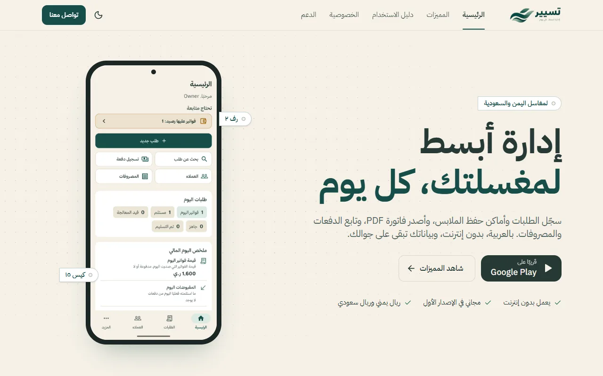
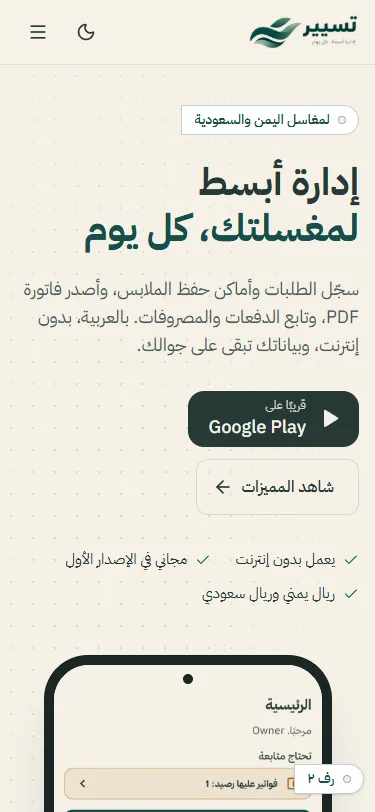
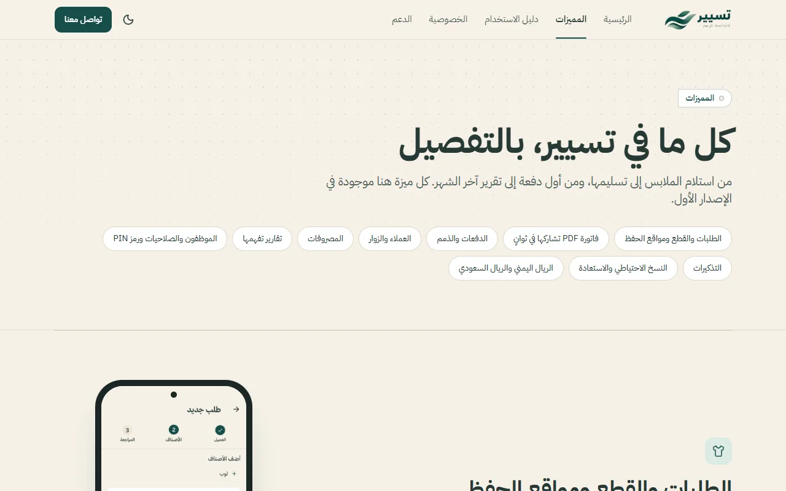
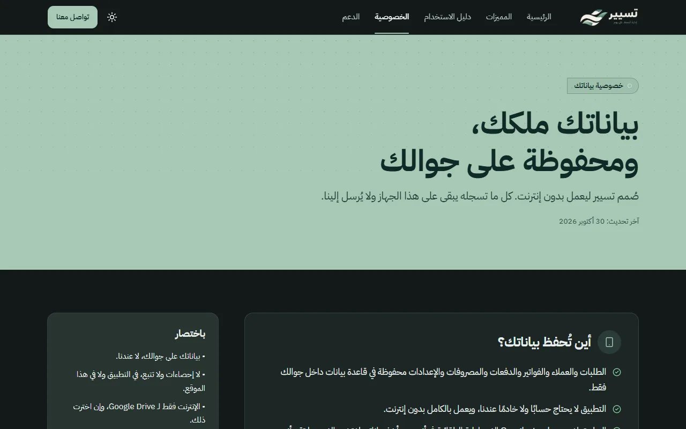

<div align="center">

<picture>
  <source media="(prefers-color-scheme: dark)" srcset="public/brand/logo-dark.png" />
  
</picture>

### Marketing website for **Tasyeer**, an offline-first laundry management app

<p dir="rtl"><b>تسيير</b>: تطبيق عربي لإدارة المغاسل الصغيرة في اليمن والسعودية. يعمل بدون إنترنت، وبياناتك تبقى على جوالك.</p>


</div>

---

## Preview

<p align="center">
  <picture>
    <source media="(prefers-color-scheme: dark)" srcset="docs/images/home-desktop-dark.webp" />
    
  </picture>
  &nbsp;
  <picture>
    <source media="(prefers-color-scheme: dark)" srcset="docs/images/home-mobile-dark.webp" />
    
  </picture>
</p>

<details>
<summary>More screens</summary>

| Features (light) | Privacy (dark) |
| --- | --- |
|  |  |

</details>

## Table of contents

- [About](#about)
- [Pages](#pages)
- [Tech stack](#tech-stack)
- [Getting started](#getting-started)
- [Configuration](#configuration)
- [Project structure](#project-structure)
- [Content rules](#content-rules)
- [Design system](#design-system)
- [Privacy](#privacy)
- [Asset scripts](#asset-scripts)
- [Quality checks](#quality-checks)
- [Deployment](#deployment)
- [Project status](#project-status)
- [License](#license)

## About

Tasyeer (تسيير) is a Flutter app, Android first, for small and mid-size laundries in Yemen and Saudi Arabia. It handles orders and items with storage locations, PDF invoices, multiple payments and receivables, expenses, reports, local users with PINs, reminders, and backups to the phone or Google Drive. It is free in the first release and is **coming soon to Google Play**.

This repository holds the product's website. The site explains the features, walks owners through using the app, publishes the privacy policy, and offers support. It is **Arabic only and fully RTL**, and it ships as a **static site** with no server, cookies or analytics.

## Pages

| Route | Content |
| --- | --- |
| `/` | Hero, everyday problems and how the app answers them, feature bento, 4-step flow, screenshot tabs, privacy band, owner vs. employee, short FAQ, call to action |
| `/features/` | Every feature in detail, plus what the first release does **not** do |
| `/guide/` | Step-by-step user guide (12 topics), generated from the app's own in-app guide |
| `/privacy/` | Privacy policy, from the app's privacy screen, plus Google Drive, notifications and this website |
| `/support/` | WhatsApp, email, contact form (Formspree), "before you write to us" checklist, full FAQ |
| `/terms/` | Terms of use, **draft** (noindex, excluded from the sitemap) |
| `404` | Branded not-found page |

Generated at build time: `sitemap.xml`, `robots.txt`, Open Graph image, icons, and JSON-LD (`SoftwareApplication` on home, `FAQPage` on support).

## Tech stack

| Area | Choice |
| --- | --- |
| Framework | [Next.js 15](https://nextjs.org) App Router with `output: "export"` and `trailingSlash: true` |
| Language | TypeScript |
| Styling | [Tailwind CSS v4](https://tailwindcss.com); tokens live in `app/globals.css`, so there is no `tailwind.config` |
| Components | [shadcn/ui](https://ui.shadcn.com) (Radix base, RTL enabled) and [Lucide](https://lucide.dev) icons |
| Motion | [Motion](https://motion.dev) (`motion/react`) with `MotionConfig reducedMotion="user"` |
| Forms | react-hook-form + zod, posting to [Formspree](https://formspree.io) |
| Theming | next-themes (light, dark, system) |
| Font | IBM Plex Sans Arabic 400/500/700 via `next/font`, self-hosted at build time |

## Getting started

**Requirements:** Node.js 20 or newer, and npm.

```bash
git clone https://github.com/MokarmDev/tasyeer-web.git
cd tasyeer-web
npm install
```

| Command | What it does |
| --- | --- |
| `npm run dev` | Dev server with hot reload at <http://localhost:3000> |
| `npm run lint` | ESLint (Next.js core-web-vitals and TypeScript rules) |
| `npm run build` | Static export to `out/` |
| `npx serve out` | Serve the built site locally to check the real output |

> `npm start` (`next start`) does not apply to a static export. Serve `out/` instead.

## Configuration

Copy `.env.example` to `.env.local` and fill in what you have:

| Variable | Purpose | Default |
| --- | --- | --- |
| `NEXT_PUBLIC_SITE_URL` | Canonical domain for metadata, sitemap and JSON-LD | `https://tasyeer.example` (placeholder) |
| `NEXT_PUBLIC_FORMSPREE_ENDPOINT` | Contact form endpoint, e.g. `https://formspree.io/f/xxxxxxx` | empty: the form shows a "not set up yet" message |

The WhatsApp number, support email, store status and legal dates live in [`content/site.ts`](content/site.ts). `site.isPlaceholder` flags any value that is still a stand-in.

## Project structure

```text
app/
  layout.tsx              <html lang="ar" dir="rtl">, font, theme, header and footer
  (site)/                 page.tsx, features/, guide/, privacy/, support/, terms/
  not-found.tsx           404
  sitemap.ts, robots.ts   generated as static files
  opengraph-image.png     social preview (from scripts/make-og.mjs)
components/
  ui/                     shadcn primitives
  site/                   header, footer, phone-frame, theme-toggle, whatsapp-fab, contact-form, tag…
  sections/               home page sections
content/                  all copy: site, features, faq, guide, privacy, terms
lib/                      cn(), page metadata helper, date formatting
public/brand, public/screens   logos and app screenshots (webp)
scripts/                  asset preparation and OG image
design-system/tasyeer/    MASTER.md, the web design system
docs/                     reference patterns and README images
```

## Content rules

All copy lives in `content/*.ts`, never inside components. Every claim must match the product:

- the PRD and the code of the Tasyeer app,
- the app's own strings (`assets/translations/ar.json`). `content/guide.ts` and the app part of `content/privacy.ts` are generated from the `guide_*` and `privacy_*` keys, so the site says exactly what the app says.

No invented features, prices, store availability or legal commitments. The first release is free, and the call to action stays «قريبًا على Google Play» until the app is published.

**RTL conventions:** use logical utilities (`ms-`, `pe-`, `start-`, `end-`, `text-start`), never `left`/`right`. Wrap numbers, codes and Latin words in `.ltr-iso` or `<bdi>`. Never split Arabic text into letters for animation, because it breaks letter joining.

## Design system

The tokens come from the app's design system, so the site and the app look like one product. Full spec: [`design-system/tasyeer/MASTER.md`](design-system/tasyeer/MASTER.md).

| Token | Light | Dark |
| --- | --- | --- |
| Background | `#F6F1E7` cream | `#121A19` |
| Card | `#FFFFFF` | `#1C2624` |
| Text | `#263936` | `#E8EFEC` |
| Primary | `#164E49` petrol | `#A7C9B5` sage |
| Muted text | `#4C5C59` | `#B9C7C3` |
| Border | `#DDD6C8` | `#34423F` |

- Status colors (success, info, warning, error) match the app's `AppStatusColors`, with AA contrast in both themes.
- Radii 8, 12 and 16; spacing on a 4px grid. Depth comes from the cream page against white cards, not from shadows.
- Signature detail: the **laundry tag** («رف ٢»، «كيس ١٥»), taken from the storage labels the app attaches to orders.

## Privacy

The site follows the same rule as the app:

- No analytics, no tracking, no cookies, no third-party scripts.
- Fonts are self-hosted, and the theme choice stays in the visitor's `localStorage`.
- The only outbound request is the support form to Formspree, and only when someone submits it.

## Asset scripts

The app repository (`../tasyeer-app`) is the read-only source of logos and screenshots.

```bash
# Copy logos and icons, crop the status bar off screenshots, convert to webp
node scripts/prepare-assets.mjs ../tasyeer-app
```

```bash
# Rebuild app/opengraph-image.png from the logo and a screenshot (no text rendering)
node scripts/make-og.mjs
```

## Quality checks

Before each release:

- [ ] `npm run lint` and `npm run build` pass
- [ ] Every page at **375 / 768 / 1280 px** in **light and dark**: correct RTL, no horizontal scroll, no broken images
- [ ] Keyboard navigation works: skip link, visible focus, logical order
- [ ] `prefers-reduced-motion` leaves all content visible
- [ ] Text contrast meets WCAG AA in both themes
- [ ] Privacy copy still matches the app's real behavior

The project ships Claude Code skills in `.claude/skills` for design review: `tastegate`, `anti-slop-design`, `web-design-guidelines`, `emil-design-eng` and `ui-ux-pro-max`.

## Deployment

`npm run build` writes a fully static site to `out/`. Any static host can serve it, and Vercel works with its default Next.js settings. Set `NEXT_PUBLIC_SITE_URL` (and the Formspree endpoint, if ready) in the host's environment before building.

## Project status

| Item | Status |
| --- | --- |
| All pages, SEO, light and dark themes | ✅ Done |
| WhatsApp number and support email | ✅ Set |
| Production domain | ⏳ Pending |
| Formspree endpoint | ⏳ Pending |
| Thmanyah font | ⏳ Waiting on web-license confirmation; IBM Plex Sans Arabic until then |
| Terms of use | 📝 Draft, pending legal review |
| Google Play link | ⏳ After the app is published |

## License

No license has been chosen for this repository yet.

<div align="center">
<sub>تسيير — إدارة أبسط، كل يوم</sub>
</div>
